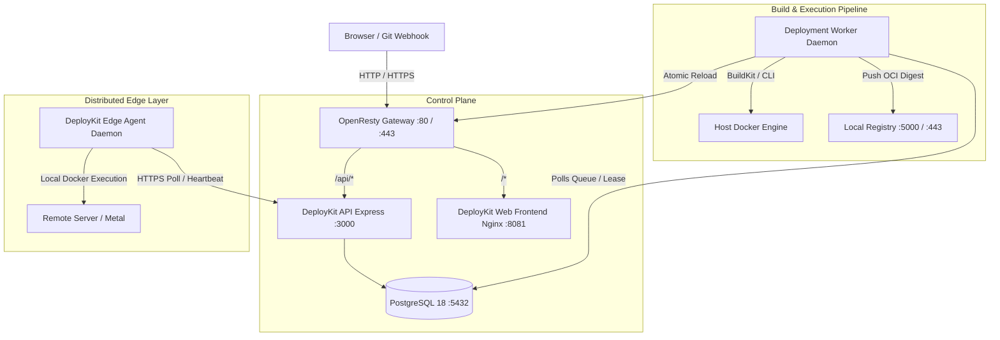
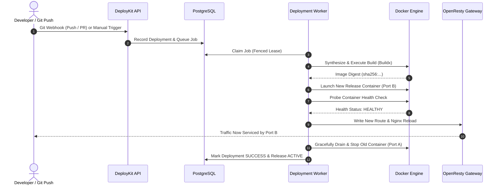

# DeployKit — System Architecture & Internals

DeployKit is built as a self-hosted, modular Platform-as-a-Service (PaaS). It provides git-driven automated container builds, immutable release artifact generation, zero-downtime blue/green deployment switching, distributed edge server execution, and automated ACME TLS certificate management.

---

## 1. High-Level Architecture Diagram

---

## 2. Core Subsystems

### 2.1 API Service (`apps/api`)
- **Technology**: Node.js 22 LTS, Express 5, TypeScript.
- **Responsibilities**:
  - Authenticated REST API for dashboard and CI/CD operations.
  - Project management, encrypted environment variables, and build configuration.
  - User session lifecycle, role-based access control (Admin / Member), and invite token management.
  - GitHub App integration (OAuth setup, webhook delivery verification via HMAC-SHA-256).
  - Edge agent enrollment, token verification, and heartbeat ingestion.
  - Incident tracking and automated health state transitions.

### 2.2 Deployment Worker (`apps/api/src/workers/deploymentWorker.ts`)
- **Technology**: Standalone background Node.js process.
- **Responsibilities**:
  - Concurrency-controlled, fenced job queue consumer (`SELECT ... FOR UPDATE SKIP LOCKED` with timed leases).
  - Preflight workspace detection (Node.js, Python, Go, Rust, Ruby, PHP, Dockerfile, static HTML).
  - BuildKit / Dockerfile synthesis, multi-stage container compilation, and deterministic caching.
  - Image pushing to internal TLS registry with immutable `sha256:...` digest verification.
  - Container health check orchestration (probes runtime container before traffic cutover).
  - Blue/Green atomic gateway route synchronization.
  - Automated image garbage collection (sweeps unreferenced digests when disk usage exceeds soft/hard thresholds).

### 2.3 OpenResty Dynamic Gateway (`ops/gateway`)
- **Technology**: OpenResty / Nginx with Lua runtime.
- **Responsibilities**:
  - Dynamic reverse proxy terminating ports 80 and 443.
  - Reads active project release endpoints from `/etc/nginx/routes/*.conf`.
  - ACME HTTP-01 challenge responder for Let's Encrypt automated TLS issuance.
  - Static internal TLS registry proxy (`deploykit-registry-tls:443`).
  - Zero-downtime routing: changes are staged and atomic-reloaded (`nginx -s reload`).

### 2.4 Distributed Edge Agent (`apps/api/src/edgeAgent.ts`)
- **Technology**: Minimal standalone Node.js daemon (or Docker container `deploykit-edge-agent`).
- **Responsibilities**:
  - Connects remote bare-metal servers or cloud VPS instances to the central control plane.
  - Polls for deployment jobs bound to its assigned `projectId`.
  - Executes container runtime lifecycles on the edge machine.
  - Reports status, logs, and periodic heartbeat timestamps back to the central API.

### 2.5 PostgreSQL Database (`database/migrations`)
- **Technology**: PostgreSQL 18 with 24 schema migrations.
- **Key Tables**:
  - `projects`: Application metadata, repository links, build configuration JSONB.
  - `project_members`: Multi-tenant user ownership and role mappings (`owner`, `collaborator`).
  - `deployments`: Deployment flight records, git commit SHAs, status state machine, error telemetry.
  - `deployment_jobs`: Fenced worker queue with concurrency leases, worker IDs, and lease expiry.
  - `releases`: Immutable release snapshots with verified image digests, container ports, and health status.
  - `runtime_instances`: Running container metadata, port mappings, and health heartbeat tracker.
  - `project_env_vars`: AES-256-GCM encrypted project environment secrets.
  - `project_agents`: Registered remote edge agent nodes and hashed credentials.
  - `custom_domains` & `custom_domain_tls`: Domain routing rules and ACME certificate records.
  - `incidents`: Automated failure detection, alerts, and incident resolution tracking.

---

## 3. Deployment Lifecycle & Zero-Downtime Blue/Green Transition

---

## 4. Concurrency, Distributed Locking & Crash Recovery

- **Advisory Locks**: Migration and critical schema operations use deterministic Postgres advisory locks (`4_217_311_902`).
- **Fenced Leases**: Jobs are claimed with a worker token and lease timeout (`WORKER_LEASE_MS=30000`). If a worker crashes mid-flight, the lease expires safely and the job is reclaimed or marked failed without hanging the queue.
- **Compare-and-Set Activations**: Only one active release is allowed per project at any time. Database triggers and atomic updates prevent split-brain routing.
