# DeployKit — Edge Servers & Distributed Infrastructure

DeployKit allows you to attach remote bare-metal servers, home lab machines, or cloud VPS nodes directly to your projects. Instead of running all applications on the main control plane server, you can disburse workloads to edge nodes while retaining centralized deployment, secrets, and log monitoring.

---

## 1. How Edge Architecture Works

```mermaid
sequenceDiagram
    participant Web as Web Dashboard
    participant API as DeployKit Control Plane
    participant DB as PostgreSQL
    participant Agent as Edge Agent (Remote Host)
    participant Docker as Remote Docker Engine

    Web->>API: Enroll New Server ("us-east-metal1")
    API-->>Web: One-Time Token (32-byte cryptographic secret) & Docker Command
    Note over Agent: User runs `docker run ...` on remote host
    Agent->>API: Send Heartbeat + Token (HMAC-SHA-256 Auth)
    API->>DB: Record Agent Status: ONLINE

    rect rgb(20, 30, 40)
        Note over API,Agent: Flight Dispatch
        API->>Agent: Deliver Deployment Payload (Image Digest + Encrypted Secrets)
        Agent->>Docker: Pull Image & Launch Container
        Agent->>API: Stream Logs & Health Status
    end
```



---

## 2. Enrolling an Edge Server via the Dashboard

1. Navigate to your project in the DeployKit Web Console.
2. Click the **Servers** tab in the navigation bar.
3. Click **Enroll Server**.
4. Enter a name (e.g. `hetzner-fsn-node1`, `aws-eu-central`, or `home-lab-worker`).
5. Click **Generate Credentials**.
6. DeployKit generates:
   - **Agent Token**: A 32-byte high-entropy secret (e.g. `dk_agent_...`).
   - **Docker Run Command**: The ready-to-run container launch snippet.

> [!IMPORTANT]
> For security, the agent token is presented **only once**. DeployKit stores only the peppered cryptographic hash (`HMAC-SHA-256`) in the database.

---

## 3. Running the Agent on Your Remote Server

SSH into your remote server and execute the generated Docker run command:

```bash
docker run -d \
  --name deploykit-edge-agent \
  --restart unless-stopped \
  -v /var/run/docker.sock:/var/run/docker.sock \
  -e DEPLOYKIT_CONTROL_PLANE_URL="https://deploykit.yourcompany.com" \
  -e DEPLOYKIT_AGENT_TOKEN="<YOUR_ONE_TIME_AGENT_TOKEN>" \
  -e DEPLOYKIT_LOG_LEVEL="info" \
  ghcr.io/manishakumari21/deploykit-agent:latest
```

### Running Natively via Node.js
If you prefer running the agent as a systemd service:

```bash
git clone https://github.com/Manishakumari21/DeployKit.git /opt/deploykit
cd /opt/deploykit/apps/api
npm install
npm run build

export DEPLOYKIT_CONTROL_PLANE_URL="https://deploykit.yourcompany.com"
export DEPLOYKIT_AGENT_TOKEN="<YOUR_ONE_TIME_AGENT_TOKEN>"
node dist/edgeAgent.js
```

---

## 4. Revoking an Edge Server

If a remote node is decommissioned or compromised:
1. In the **Servers** tab, locate the server node.
2. Click **Revoke**.
3. Confirm revocation in the security dialog.
4. DeployKit immediately invalidates the stored token hash and refuses any subsequent heartbeats or flight assignments from that node.
